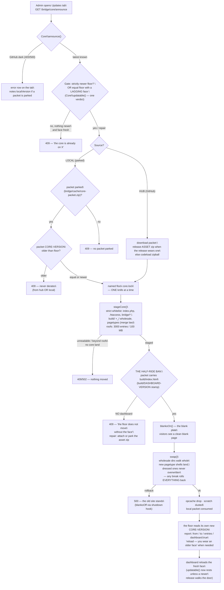
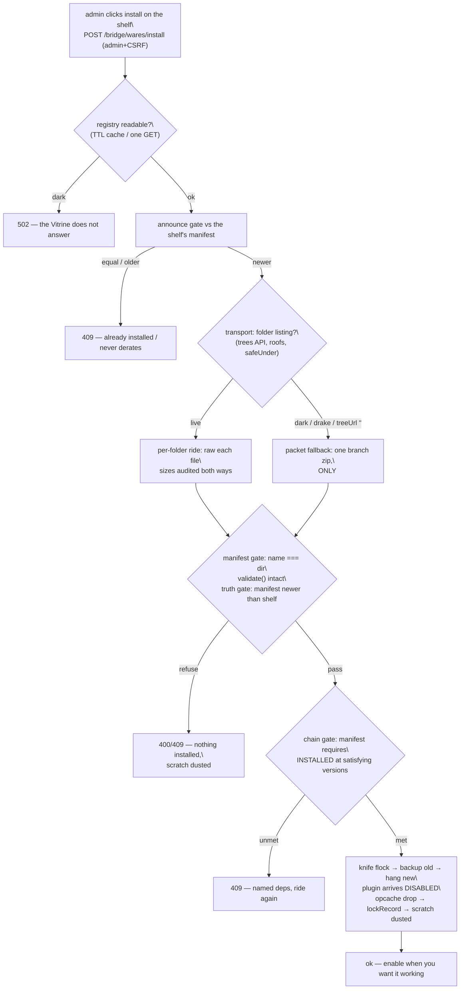

<!--
1. Relative path: MCP/guardrails.md
2. Description: PIPELINE GUARDRAILS — the exhaustive lid law for the plugin
   (wares) pipeline and the core/self-update cycle: every gate a ware and a
   packet must pass, the flowchart of the update cycle, and the audit's open
   TODOs. Written 2026-11-07 (user order) after the half-ride incident and a
   30-case hostile battery against a sandbox. The shape follows GOSPEL.md.
3. Expects: Nothing — this file is the law's bookkeeping for pipeline flows.
4. Provides: (I) Plugin pipeline guardrails — install through enable through
   runtime through removal. (II) THE UPDATE FLOWCHART (mermaid). (III) Audit
   record + open TODOs. (IV) The bullet-proof update cycle. (V) The core-update
   second pass. (VI) The template/plugin × core boundary audit (the 16-case
   boundary battery). (VII) The preview door — a page, not a frame (the
   withdrawn SAMEORIGIN exception). (VIII) The Bienenstich (API) ware — the
   boundary audit (the 51-case battery). Batteries: /tmp/opencode/wares-battery.php (30 cases) and
   /tmp/opencode/boundary-battery.php (16 cases) against the sandbox
   /tmp/opencode/schmarrn-audit (rerun: rebuild sandbox from the bakery tree,
   fake shelf served via file:// in bridge/config/wares.local.php).
5. SPDX-License-Identifier: MPL-2.0
6. Copyright (c) 2026 Homahuki GmbH
-->

PIPELINE GUARDRAILS (wares + update cycle)

---

## I. The plugin (ware) pipeline, gate by gate

The whole chain rides ONE principle (GOSPEL, unchanged): **a broken install
degrades to a log line — never a dead site.** Every gate below refuses with a
named 4xx/5xx JSON before anything moves.

### 1. Identity law
- Ware dir name AND registry name AND manifest name: `[a-z0-9]+(-[a-z0-9]+)*`.
- Registry `path` must start with the kind's own dir (`plugins/`, `templates/`)
  and `basename(path) === name` — a path pointing elsewhere is off the shelf.
- Plugin route names, placeholder names, contentFilter keys, editorBlock names:
  namespaced by the ware's own identifier (`<name>_` or underscored `-`→`_`),
  regex-checked at `Plugins\validate()` — no cross-ware hijinks.

### 2. The registry window (Vitrine fetch)
- `wares.json` — one GET, no token, schema 1, TTL cache (300 s) in
  `bridge/cache/wares-registry.json`; a dark Vitrine degrades to an error row
  on the shelf, never a crash.
- Junk in the window display is dropped row by row — one bad ware never
  hides the honest ones.
- URLs overridable in git-ignored `config/wares.local.php` (local test shelf;
  `treeUrl ''` turns the per-folder ride off and every install rides the packet).

### 3. Transport law — two houses, one staging shape
- **Primary (per-folder ride):** the trees API lists the ware's OWN folder once
  (`truncated == false` or no trust), raw carries each file. Names audited
  `safeUnder` (no absolute, no climb, no dot tricks — one rogue name makes the
  whole listing untrustable). Sizes audited against the arrival — announced
  size AND counted truth join the byte sum (null-size files dodge NO roof).
- **Fallback (packet ride):** one codeload zip of the branch; ONLY
  `<ware-path>/` entries are extracted; entry names `safeUnder`-checked before
  extraction (zeppelin- and climb-proof — battery C6).
- Roofs: 1000 files / 100 MB per ride (`FOLDER_FILE_CAP` / `FOLDER_BYTE_CAP`).
- **One knife at a time:** installs (and template deletions) ride under the
  named flock `bridge/cache/wares.lock` — a second knife is refused 409. The
  shutdown hook always rests the knife (no dust, same law as the core ride).

### 4. Gate sequence in `Wares\install()` — in order, every ride
1. Name shape (400).
2. Registry readable (502) — no Vitrine, no install.
3. `requiresSchmarrn` satisfied by the host floor (400).
4. **Announce gate** — strictly newer registry version than the shelf's own
   manifest moves files; equal = already installed; older = never derates.
   An unreadable husk (no readable version manifest on the shelf) counts as
   replaceable.
5. Stage (folder → else packet) — refuse on dark/mismatched transport (no half
   arrival; the staging shape is identical either way).
6. **Manifest gate** — `plugin.json` must name itself (`name === dir`),
   `Plugins\validate()` must accept it intact (this is where a malformed
   `requires` dies: shape, self-require, cross-checks live in `Chain\parse`).
   Templates: `theme.json` must at least be a legible JSON object; deeper
   theme shape is validated at activation/deletion law below.
7. **Code gate** — the ware's CODE must resolve: `Plugins\codeCheck()` reads
   every PHP file of the arriving ware, and every global call inside must
   resolve inside the ware's own code or in PHP itself. A ware whose code
   calls a function it never declares died in transit — a duplicated letter
   inside an identifier survives the grammar (`php -l` is quiet, the eye sees
   nothing) but not the runtime, and the call burns at the door hours later,
   on the host. The refusal names the call and its line (400, nothing
   installed): "its code calls 'lint_brokenn_helper' (line 28) — functions the
   ware never declares (a mangled transfer, most likely). Nothing installed."
   Namespaced calls (`\Store\listAll()`) and method calls (`$x->foo()`,
   `new Foo()`) are none of this gate's business; a ware with no code at all
   is not its business either — the runtime lid degrades, as always. A file
   that is self-consistent (the declaration mangled the same way) is sound:
   ugly names are not the lid's affair.
8. **Truth gate** — the MANIFEST is the truth, the shelf may lie. The ridden
   manifest must still be strictly newer than the shelf (installed/equal →
   refuse, naming the shelf↔manifest drift when the two disagree).
9. **Chain gate** — the manifest's OWN requirements ("name" or
   "name >= 1.2", never self) must be INSTALLED on the host at satisfying
   versions — install asks PRESENCE; the enable switch asks LIFE.
10. **Swap** — old shelf backed into scratch, new hung, byte-opcache dropped;
   plugins arrive DISABLED (`mapWithout`) and the enable stays the user's hand.
   Rollback on a failed rename — the old shelf stands, never a hole.
11. **Lock** — `config/wares.lock.php` records who installed what, when,
    with the requirements THE MANIFEST declared. Bookkeeping only, never the
    enforced truth (the Chain Law made the manifest the single source).

### 5. The enable switch (PUT /bridge/plugins) and THE CHAIN LAW
- State = intent (`plugins.local.php`) ∧ derived effectiveness. A ware is
  **effective** only when its intent switch is on AND every requirement is
  effective at a satisfying version, walked to a fixpoint (≤ 64 rounds).
- Orphaned enable-states are unconstructible: only INSTALLED plugins may be
  toggled, and a requested-on plugin whose chain never completes is refused
  BY NAME (409) before any state is written.
- Rings never promote — they sit visibly blocked (`blockedBy` names them) at
  the shelf and at the switch, until a human breaks the circle (battery C7).
- Recursion depth cap: a chain deeper than 64 is a ring in a coat.

### 6. Runtime lid (`Plugins\dispatch()` and the serve-time faces)
- Auth and CSRF are enforced by the CORE per the manifest, before a handler
  ever runs: `public` (no session needed), `user` (session), `admin` (+role);
  CSRF on every non-GET of a sessioned route — the handler never remembers.
- The handler answers JSON: `_status` (array) sets the HTTP code; anything
  else it returns is dressed to `{"body": ...}` — dough from a handler
  answers 200 JSON, never a fatal, never a half-page (battery C8).
- Plugin CODE loads only when the plugin is EFFECTIVE; a broken load is
  skipped with a log line in-place (`Plugins\load()`), placeholders return
  empty, contentFilters fail open (untouched HTML), drawer handles just
  don't show. Nothing is a dead site.
- Thrown exceptions inside a route/filter/fill: log + clean JSON refusal,
  HTML unchanged.

### 7. Removal laws
- Templates: the ACTIVE theme is untouchable; a ware an EFFECTIVE ware stands
  on is not deleted; the LAST template stands (a site is never themeless);
  the shelf dir is renamed into the cache tomb before dusting — never a
  half-deleted theme; the lock box leaves with it.
- Plugins: disable-first on upgrade (`mapWithout`) and intent removal rides
  the same switch law — a ware whose dependents are effective is refused by
  the enable switch before anything breaks.
- **Plugin deletion (`POST /bridge/plugin/delete`, 2026-11-10, user order):**
  admin + CSRF, refused by the core's own door before the shelf is touched;
  a name that is not slug-shaped is 400; a plugin that is not installed is
  404; a plugin an EFFECTIVE plugin stands on is 409 — "'Stop Motion' stands
  on 'drunken-monk' — disable it before the deletion." **NO plugin is
  undeletable:** the house-default law is a TEMPLATE law (the site must
  never stand on nothing), a plugin is decoration, the preinstalled default
  included. Atomicity: the shelf dir is renamed into the cache tomb first —
  never a half-deleted plugin — then dusted; the provenance line leaves the
  lock (`lockForget`) and the switch leaves the state file
  (`Plugins\forgetState()` — the RAW map, since `enabled()` only carries the
  switched-on entries and the switched-off ones must go too).

---

## II. THE UPDATE FLOWCHART (core self-update)



### The wares install flowchart (`Wares\install()`)



---

## III. Audit record (2026-11-07) and open TODOs

**Proven:** 30-case hostile battery, 6 sandbox core rides, all green —
announce/truth gates, chain law (self-require, absent dep, version gap, ring
promotion, fixpoint wake-up), zeppelin zip entries, lying announces, name
mismatches, broken-plugin degradation, folder ride + size-tamper fallback.

**Shipped fixes (this session, user-ordered):**
- [x] THE HALF-RIDE BAN enforced in `Core\update()` (was a note, now a
  refusal before the knife leaves the drawer).
- [x] `build/DASHBOARD-VERSION` stamp (ship script) + `Core\dashboardVersion()`
  + one server-side `Core\updatable()` verdict — no more half-state faces.
- [x] `Plugins\dispatch()` — a handler's non-array return no longer fatals
  ("Cannot unset string offsets"); dressed to `{"body": ...}` JSON (verify:
  battery C8 + isolation repro).
- [x] `Wares\install()` rides under a named knife flock
  (`bridge/cache/wares.lock`) — no concurrent double-swap.
- [x] `Wares\stageFolder()` — null-size listing entries can no longer dodge
  the byte roof; arrivals count toward the cap in both transports.

**Open TODOs (user's hands / next session):**
- [ ] *Shelf↔manifest version divergence:* `status()` shows `missing` by the
  registry's bare names while the install lid judges the manifest's versioned
  chain — a shelf button can read "install" and the lid refuses with names.
  Fix belongs in registry schema v2 (carry versioned requires) — registry
  rewrite needed (also touches `10_Vitrine/wares.json`).
- [ ] *Layout-precedence edge:* the served face prefers `_/`, while
  `dashboardVersion()` reads `../build/` FIRST — only reachable on hybrid
  hosts carrying both (FTP-copied repo + build/). Decide one precedence or
  make the verdict compare BOTH stamps.
- [ ] *Vitrine rate limits:* an unauthenticated GitHub API budget (60/h) can
  darken the trees listing under repeated installs — the packet fallback
  degrades gracefully (proven), but a TTL cache for `folderIndex()` listings
  would keep the fast path fast.
- [ ] *CSRF opt-out:* `capabilities.routes[].csrf: false` is lawful for
  plugin authors (localhost-style pong routes). If a ware from the wild ever
  needs disabling, tighten the lid to CSRF-on-always — contract change, user
  decision required.
- [ ] *One knife namespace:* template activate/delete and plugin toggles are
  single-file writes (atomic rename) and ride no lock; if a future feature
  makes them multi-file, move them under the `wares.lock` knife like
  installs and template deletion.
- [ ] *Lock re-sync:* a drifted `wares.lock.php` only mirrors; there is no
  administrative "repair the lock" verb. Add one ONLY when a real drift bites
  — the manifest is the truth by law.
- [ ] *Battery as CI:* the wares battery lives in `/tmp` by nature — a
  committed `scripts/wares-battery.php` (sandbox-shaped, file:// shelf) would
  make this a one-command regression gate before every release.

---

## IV. THE BULLET-PROOF UPDATE CYCLE (2026-11-07, user-ordered — the definitive law)

One cycle, thirteen gates, from "admin clicks update" to "the floor wears a
new face". Every gate has a verdict for the code as it stands today:
`HOLDS` (proven by the sandbox rides or by reading), `DRIFTS` (the code
promises, the code does not keep — a finding), or `OPEN` (a hardening the
law wants and the code never carried). Each `DRIFTS`/`OPEN` carries its
finding number → §V.

- **G0 · Source law — HOLDS.** The update rides from exactly one of two
  houses: `hub` (GitHub's announce) or `local` (the parked packet at
  `bridge/cache/core-packet.zip`). Anything else is a 400. An EQUAL version
  rides only as a REPAIR — and only when the face (`dashboardVersion()`)
  lags or is unmarked; the outage handle keeps an equal local ride lawful
  for repair. An OLDER version NEVER rides, from either house.
- **G1 · Source truth — HOLDS.** The newest version is the SEMVER MAX over
  the PAGED `releases` list (100 per page, full pages walked to the end of
  the line, ten pages the safety rail — U7 fixed 2026-11-07) — never
  `releases/latest` alone (its ordering is creation, not semver — the
  v1.2.5 lesson). Tag-shaped junk and prerelease suffixes are filtered. The
  TAG LIST answers only when zero releases exist. A version without a
  release does not exist to this line.
- **G2 · Packet bearing — HOLDS.** The hub packet is the winning release's
  OWN zip asset (the FIRST schmarrn-named zip wins, deterministically — U6
  fixed 2026-11-07); no asset → the codeload zipball as the floor. Streamed
  into the scratch, never into the site.
- **G3 · Download roof — HOLDS (U4 fixed 2026-11-07).** The download streams
  under the 100 MB roof MID-FLIGHT (`Core\fetchPacket()`): a mad or
  malicious asset is cut off at the cap, the partial never lands, memory
  never holds the whole packet. Proven: a 105 MB packet via `file://` →
  refused, partial removed; a lawful packet rides whole.
- **G4 · Packet truth gate — HOLDS (U1 fixed 2026-11-07).** THE LAW: the
  packet's own `bridge/CORE-VERSION` is the truth, the announce is the
  advertisement — the same manifest-over-shelf law the wares pipeline
  answers to. BOTH paths read it: local refuses without it and never
  derates; hub peeks the packet right after download and refuses unless
  the packet confesses the announced tag (a stale or mislabeled asset on a
  fresh release derates no floor). Proven live: the codeload zipball of
  v1.2.8 confessed 1.2.8 and passed.
- **G5 · Core-land staging — HOLDS.** `stageCore()`: whitelist only
  (`isCore()` — `index.php`, `.htaccess`, `bridge/*.php`, non-LOCAL config
  defaults, `bridge/CORE-VERSION`, wholesale `build/` `_/` `bridge/assets/`
  `bridge/lib/`, merge-law `pagetypes/*.md`), entry names audited
  `safeUnder` (no absolute, no climb, no dot), roofs 3000 entries / 100 MB,
  no core land → refuse. Nothing a user owns is reachable, by path law.
- **G6 · The half-ride ban — HOLDS.** After staging, BEFORE any knife: the
  packet must carry `build/index.html` or the ride is a 409 refusal — no
  blanko, no swap, no half-state. The dashboard peek reads the staging's
  top dir OR its own root (the same flat-packet tolerance `swap()` carries
  — U8 fixed 2026-11-07; a truly flat packet still dies lawfully at
  staging's one-top-dir law). The face travels with the floor or the floor
  does not travel. Proven live: the codeload zipball (no `build/`) → 409,
  floor and face untouched.
- **G7 · Auth + CSRF — HOLDS.** `GET /bridge/core` admin-only;
  `POST /bridge/core/packet` and `POST /bridge/core/update` admin-only +
  `assertCsrf()`. The knife never answers an unlogged hand.
- **G8 · One knife, honestly — HOLDS (U2 fixed 2026-11-07).** Named flock
  `bridge/cache/core.lock`, `LOCK_NB` — a second update is a 409. The lock
  FILE is never unlinked, on refusal or on rest: a refused waiter that
  deletes the file launders the mutex out from under the holder (proven
  race: A holds inode X, B unlinks, C flocks a fresh inode and rides
  beside A — `lockrace.php`). The name outlives the blade; zero-byte lock
  dust in a writable cache is the honest price. Proven fixed: A holds, B
  refuses leaving the file, C's flock fails on the SAME inode — one knife,
  one cook; after the rest, the next in line takes it clean. The wares
  knife answers the same law since the optimization pass (U3 fixed
  2026-11-07) — no lock file in this house is ever unlinked.
- **G9 · The blanko window — HOLDS (U5 fixed 2026-11-07).** The marker
  `bridge/cache/core-blank` drops (`blankoOn()`) only AFTER all gates and
  the manifest/dashboard skin checks pass; every other request eats a clean
  blank plate (root `index.php`), the API a 503 JSON with `Retry-After`.
  The shutdown hook lifts the marker on success, error, `die()`, and fatal
  alike — and the marker carries its own TTL (`BLANK_TTL` = 300 s): a hard
  SIGKILL/power drop leaves at most five minutes of plate, then every
  reader (`blankKnives()`) sweeps the stale marker and the site walks on
  un-blanked. Proven: fresh marker → the plate; 8-minute-old marker →
  swept at both doors, request served.
- **G10 · The swap — HOLDS (U-CLEAN fixed 2026-11-07).** Wholesale dirs
  first (whole dir in, old whole out to the scratch), then merge-law
  pagetypes (new shells only), then named files one `placeSimple()` at a
  time — and EVERY swap, file AND wholesale dir alike, registers in the
  restore scope: one break rolls EVERYTHING back, dirs included, the old
  vaults consumed by the restore itself. PROVEN: the poison repro that
  once left `build/` wearing the NEW face after a "rollback" now answers
  the same error with `build/` carrying the OLD face whole, the dir
  backup consumed, the named file untouched. "The old core stands" is a
  true sentence again.
- **G11 · Bytecode + scratch law — HOLDS.** `opcache_invalidate` walks
  every swapped file (per-file forced) + `CORE-VERSION`; the scratch is
  dusted after everything is settled — after the total restore or the
  total success, never between; a local packet is consumed only after
  success.
- **G12 · The honest verdict — HOLDS.** The report answers `from` (the
  floor's own word before the ride), `to` (the floor's word AFTER — the
  truth, not the announcement), `announced`, `entries`, `newPagetypes`,
  `dashboard: true` (the ban guarantees it), and names repair rides.
- **G13 · Aftermath — HOLDS.** `updatable()` is the ONE server-side
  verdict (newer floor; equal floor with lagging/unmarked face); the tab
  reads `current` / `latest` / `dashboard` / `updatable` / `localVersion`
  and offers no ride the verdict refuses.

**The cycle in one sentence:** *the source announces, the packet confesses
its own version, the dashboard must ride along, the knife stays honest and
never vanishes, the site eats a blank plate with a guaranteed expiry, and
the swap either fully lands or fully unlands — the old core stands or the
new core stands, never both, never neither.*

---

## V. Core-update audit — second pass (2026-11-07, user-ordered)

Two dead-body repros and three code-cited findings; the first-pass wares
audit (§III) stands untouched.

| # | Severity | Finding | The body |
|---|---|---|---|
| U-CLEAN | **CRITICAL** | `Core\swap()` rollback hole: wholesale dir swaps (`build/`, `_/`, `bridge/assets/`, `bridge/lib/`) are NOT registered in `restore()`; a later named-file failure rolls back only the files, leaves the fresh dirs in place, and `update()`'s `partWith($scratch)` then destroys the dir backups. Error text lies: "the old core stands" is false. | Repro: staged packet with `build/` + a poison at `bridge/config/auth.php` → `build/` carried NEW FACE, `dir-backup-build` burned by `partWith()`. |
| U2 | HIGH | `Core\update()` refusal path (line 652) unlinks `core.lock` while an update holds it → the mutex is laundered; a fresh waiter flocks a new inode and a SECOND update proceeds beside the first. | Repro `lockrace.php`: A holds inode 6165688, B refuses + unlinks, C flock(new inode) == true. Fix: NEVER unlink the lock file — leave the zero-byte dust. |
| U3 | MEDIUM | `Wares\install()`'s shutdown hook unlinks `wares.lock` holder-side — same laundering window between `flock(UN)` and the next waiter's `flock()`. Honesty law: no unlink, ever. | Code cite `bridge/wares.php:467`. |
| U1 | HIGH | The hub ride never reads the packet's own `CORE-VERSION` (`peekPacket()` is local-only): a stale/mislabeled asset attached to a fresh release DERATES the floor and splits face/floor — the never-derate law, bypassed. Fix: `peekPacket()` after download; refuse unless version ≥ floor AND == the announced tag. | Code cite: `peekPacket` callsites 580/587/608 — hub path (617-645) absent. |
| U5 | MEDIUM | The blanko marker has no TTL: a SIGKILL/power drop mid-update leaves the site permanently blank until a hand removes `bridge/cache/core-blank`. Fix: the reader (root `index.php` blanko check) treats a marker older than N minutes (the file carries `date('c')`) as no knife and sweeps it. | Code cite: `index.php:23` checks `is_file()` only; `blankKnives()` same. |
| U4 | MEDIUM | The hub download is unbounded memory (`file_get_contents($packet)`); the 100 MB roof answers only for staged core land, not the arriving packet. Fix: stream to the scratch with a byte cap (the C underside of the same roof), or at minimum roof `strlen($bytes)` before write. | Code cite: `core.php`, hub branch, `$bytes = httpGet($packet)`. |
| U8 | LOW | Flat packets (no top dir) extract their core land into the staging ROOT, and `swap()` handles that — but the half-ride dashboard peek reads only `glob($staged.'/*', GLOB_ONLYDIR)`, finds no dir, and refuses a dashboard that IS staged. Inconsistent with the swap's own shape-tolerance. | Code cite: `core.php` dashboard check `$top = glob($staged.'/*', GLOB_ONLYDIR)` vs `swap()`'s `$staged = $staging` fallback. |
| U6 | LOW | `assetIn()`: multiple schmarrn-named zip assets on one release — the LAST one wins (loop overwrites on every schmarrn match). Deterministic pick: first schmarrn-named asset wins; document. | Code cite: `assetIn()` final condition. |
| U7 | LOW | `announce()` reads releases page ONE only (`per_page=100`): the semver-max of a 100+-release history may live on page 2. Edge documented; the fix is paging until the max is provably local. | Code cite: `releases?per_page=100`, single GET. |
| U9 | LOW | `ship-release.sh` never cross-checks the TAG argument against `bridge/CORE-VERSION`/`package.json` — a mistyped tag stamps `build/DASHBOARD-VERSION` with a version the floor never carries, and the repair verdict chases a phantom. Fix: refuse unless `bridge/CORE-VERSION` == `$VERSION`. | Code cite: `ship-release.sh:17-25`. |

**FIXED 2026-11-07 (user-ordered "fix the update Cycle") — every core finding
above, with proof; U3 alone stands open (wares cycle, one line, user's word):**

- **U-CLEAN → FIXED:** `swap()` now registers wholesale dirs in the same
  restore scope as files (`$dirBackups` + `dustDir()`); the restore consumes
  the dir vaults itself. Proof: the poison repro rerun — `build/` carries
  the OLD face after the failure, backup consumed, `auth.php` untouched.
- **U2 → FIXED:** both `core.lock` unlinks removed (refusal path and
  shutdown hook). Proof: `lockrace2` — B refuses leaving the file, C's
  flock fails on the SAME inode, D takes it clean after the rest.
- **U1 → FIXED:** the hub path peeks the packet after download and refuses
  unless its `CORE-VERSION` confesses the announced tag. Proof: live hub
  ride — the codeload zipball of v1.2.8 confessed 1.2.8 and passed the
  gate (then the half-ride ban refused it, as it should).
- **U4 → FIXED:** `Core\fetchPacket()` streams under the 100 MB roof
  mid-flight; partials never land. Proof: a 105 MB packet via `file://` →
  null, partial removed; a lawful packet rides whole.
- **U5 → FIXED:** `BLANK_TTL` (300 s) + `blankKnives()` sweeps stale
  markers at the read; both readers (root `index.php`, `bridge/index.php`)
  ask the marker's age. Proof: fresh marker → the plate; 8-minute marker →
  swept at both doors, the request walks on.
- **U6 → FIXED:** `assetIn()` — the FIRST schmarrn-named zip wins,
  deterministic; any other zip is the floor.
- **U7 → FIXED:** `announce()` pages the releases list (full pages walked,
  a short page ends the line, ten pages the rail).
- **U8 → FIXED:** the dashboard peek reads the staging top dir OR its own
  root — the same tolerance `swap()` carries. (A truly flat packet still
  dies lawfully at staging's one-top-dir law — the packet shape is the
  contract.)
- **U9 → FIXED:** `ship-release.sh` refuses a tag that does not confess
  `bridge/CORE-VERSION` (and cross-checks `package.json`).
- **U3 → FIXED 2026-11-07 (user order "take it into the next audit"):**
  `Wares\install()`'s shutdown hook no longer unlinks `wares.lock` — the
  blade unlocks and closes, the FILE rests, same laundering law as
  `core.lock`. Proof: flock taken and rested → the knife file stays.

**Regression green:** the 30-case wares battery 30 PASS / 0 FAIL on the
fixed tree; the local repair ride returns
`{ok, from 1.2.8, to 1.2.8, entries 86, dashboard true}`; the live hub
ride refuses the dashboard-less codeload packet with the floor and face
untouched.

---

## VI. The template/plugin × core boundary audit (2026-11-07, user-ordered — "check that the template/plugin x core boundary is impenetrable")

The compare order ran both houses: 08_Schmarrn's core against 10_Vitrine's
whole shelf (wares.json + both plugins + catflash + .htaccess doors). Battery:
`/tmp/opencode/boundary-battery.php`, 16 cases, ALL PASS on the fixed tree;
served-page byte-identity `7f2eecf2…` held before and after every fix.

### Gate verdicts (proven, case numbers = battery)

- **B4 · Drawer href smuggling — FIXED.** `str_starts_with($href, '/')` waved
  protocol-relative `//evil.example` through BOTH validators; browsers read
  `/\evil.example` the same way (WHATWG backslash normalization). Both
  `Plugins\validate()` and `Serve\themeDrawerHandles()` now refuse `//`
  prefix and any backslash. (C5, C6)
- **B5 · fill() merge order — FIXED (defense-in-depth).** Plugin placeholder
  fills merged AFTER core tokens — a plugin fill won on collision. Now core
  tokens merge LAST and structurally win. Collision is alphabetically
  impossible today (no core token contains `_`; every plugin token must —
  the prefix law), and the reorder is byte-identical on real serves. (C7 +
  the sha256 proof)
- **B8 · Ware-asset active documents — FIXED.** A theme/plugin-asset SVG
  (or HTML) hit directly executed on the site origin. They now ride the
  media sandbox law (`default-src 'none'; style-src 'unsafe-inline';
  sandbox`) in BOTH doors: root `index.php` (streamed) and `.htaccess`
  (Header expr — config-verified; no Apache in the lab). **The php -S
  lesson (proven live): `return false` in the router DISCARDS every
  router-set header — sandboxed docs hand-stream even on the built-in
  server.** Core-owned assets (bridge/assets) stay free. (C13)
- **The registry window lid — HARDENED.** The old lid
  (starts-with + basename) accepted `plugins/../climb` and
  `plugins/../../src/content/deep`; the rides caught them at use-site
  (`safeUnder` in folderIndex + extractWare's entry filter, final target
  built from the lid-validated name only). The lid now `safeUnder()`s the
  path itself — climbs die at the window. (C8, C8b)
- **The dashed-prefix placeholder bug — FIXED.** `validate()` gated
  placeholders on the DASHED `$name . '_'` while consumers call
  `plugin_<prefix>_placeholders` (underscored): a dashed-name plugin
  (`stop-motion`, `drunken-monk`…) could never lawfully declare a
  placeholder. Gate now speaks the same alphabet: `prefix($name) . '_'`.
  (C3, C4)
- **Route namespace — HOLDS by construction.** Plugin routes are
  single-segment, mounted under `/bridge/plugin/<name>/`, core cases match
  first in the switch; `plugin.php` is whitelisted NOWHERE — a direct hit
  is the public 404 and the file is never the response. (C2, C2b)
- **The plugin's shelf picture — HOLDS by the same boundary (2026-11-10).**
  A plugin may ship its own preview as `assets/preview.png` (or
  .jpg/.jpeg/.webp); `Plugins\shelfShot()` (bridge/plugins.php) finds it and
  `GET /bridge/plugins` carries `preview` (null when none). Deliberate spot:
  `assets/` is the ONLY place the plugin home serves — the plugin's CODE is
  never whitelisted, so the picture lives where the front controller already
  allows, and the door's sandbox law (B8) covers it like any ware asset.
- **Foreign-namespace hijacks — REFUSED.** A plugin declaring another
  plugin's contentFilter key (or `bodyHtml` as a placeholder) has the key
  dropped at validate; the fill/filter never runs, and the real owner's
  filter applies exactly once. (C3, C4, C7, C10b)

### The Vitrine compare fixes (10_Vitrine)

- **catflash theme.json** — `placeholders` was missing `navHtml` its own
  page.html uses (bakery/atelier list it): added. Contract now honest; the
  real catflash rode the whole wares pipeline and served with nav + css + js
  wired. (C9, C9b)
- **drunken-monk plugin.php header** — stale Schmarrn-era path
  (`bridge/plugins/…`) corrected to its Vitrine home (`plugins/…`).
- **stop-motion per-frame stat storm — FIXED.** Up to 300 `is_file` stats ×
  fence × request replaced by ONE `scandir` per declared subpath (strace:
  1111 → 818 newfstatat on a 300-frame fence; frames 300/300 both).
  Documented delta: a DIRECTORY named exactly like a declared frame counts
  as present (an absurd tray only server-filesystem hands arrange;
  degrades to one broken `` — the media route refuses directories).
  The battery also caught a `$base` shadowing bug in the first cut of this
  optimization BEFORE it shipped — the flip's locals are `$fdir/$fname`
  now, forever.

### Open — needs the user's trust-model word

- **B10 · the monk fence is an editor-leash bypass — CLOSED 2026-11-07 by the
  user's word: INTEGRITY STAMP.** `stripExecutableHtml` cuts `<script>` tags at
  an editor's publish (`Cache\storeHtml`), but a hand-crafted ```drunken-monk
  fence is a base64 CODE BLOCK — invisible to the leash — and the serve-time
  filter used to decode it into a live `<script>` (proven end-to-end before
  the fix: mint → fence survives the leash byte-identical → served page
  carried `<script data-drunken-monk="b10-demo">alert(document.cookie)…`).
  **The seal law now rules:** the admin mint route seals every envelope with
  the host's HMAC (`bridge/config/monk.local.php`, git-ignored, 64-hex secret
  minted on first use — `drunken_monk_ensureSecret()`); the stamp covers the
  EXACT applied bytes (kind+code+name, canonical JSON, `hash_hmac('sha256')`,
  verified with `hash_equals`); the serve filter applies ONLY sealed
  envelopes — hand-crafted forgeries, tampered seals (valid stamp over
  swapped code), and a missing secret file all degrade to the visible notice,
  fail-closed. The decode route answers a `sealed` verdict for inspection.
  Proven: C10/C10b (sealed applies, exactly once), C15 (forgery degrades),
  C15b (tamper degrades), C15c (no secret → nothing applies). Consequences
  the user owns: fences minted before the seal law degrade until re-minted
  (admin encode route); the installed monk on a host re-rides only on a
  STRICTLY NEWER version (lid law) — the version bump is the user's
  sovereignty alone.

### Battery harness laws (learned the hard way)

- PHP heredocs EAT `\v`, `\t`, `\r` — namespace separators in child-code
  heredocs must be doubled (`\\Plugins\\validate`), or the child parses
  garbage.
- `headers_list()` is EMPTY under the CLI SAPI (even live) — header proofs
  ride a REAL php -S door, never a CLI capture.
- `proc_open` signals the `/bin/sh` WRAPPER — the php child orphans and
  keeps serving. The battery starts php -S by direct PID (`… & echo $!`)
  and SIGKILLs that PID; a port canary proves the door before probing.
- The user's dev servers (8080, 8091) are sacred under the PORT LAW —
  battery ports are 8196+ and self-reaped.

---

## VII. The preview door (2026-11-10, user-ordered — a page, not a frame)

The Templates tab's fitting room once framed the preview route; a frame needs
a door, so the route answered `X-Frame-Options: SAMEORIGIN` while the API's
blanket `X-Frame-Options: DENY` (`bridge/auth.php`) stood on every other
door. The frame is GONE — the chosen theme shows its shelf image now, and the
live door survives as the "Preview ↗" link (a new tab) — and with it the
exception.

### The law (as it stands)

- **The preview door speaks HTML, not JSON.** `GET
  /bridge/preview/<theme>/<type>/<slug>` answers `Content-Type: text/html;
  charset=utf-8` (enforcing file: `bridge/index.php`, the preview route) — it
  is a dressed page, not an API door. This half stays.
- **The DENY stands on it, like everywhere else.** The SAMEORIGIN exception
  is WITHDRAWN: the route inherits the API's blanket `X-Frame-Options: DENY`
  (`bridge/auth.php`, `securityHeaders()`), and NOTHING on this core may be
  framed — the fitting room included.
- **The admin lid still holds.** A session (401) and the admin role (403)
  before the page is dressed — the door is admin-only, framed or not.

## VIII. The Bienenstich (API) ware — the boundary audit

A shelf ware (Vitrine, 0.1.0) that gives the CMS its API surface: three
public routes — `content` (the whole published site in one JSON call: the
site face plus every page with title, slug, url, tags, updatedAt and the
rendered body; `?body=0` for the light index, `?type=` to narrow), `search`
(a byte needle over PUBLISHED markdown only, with the matching line as the
excerpt), `status` (the heartbeat: site face, page count, version) — plus a
drawer handle. Read-only by law: it never writes, never renders Markdown (PHP
does not parse — the cache speaks) and never leaks a draft.

- **Draft neutrality** — the API hides drafts even from an admin's own
  session: the core's `/bridge/pages` lists drafts for editors, the ware's
  API does not. Same answer to every hand.
- **Battery 51 pass / 0 fail** (1 skip: the disposable rig carries no
  dashboard build): method fuzz (POST/PUT/DELETE → 405, HEAD → 404),
  parameter fuzz (path climbs, duplicate keys, array parameters, null byte,
  a 64 KB needle, emoji, quotes and angle brackets), draft neutrality anon
  AND admin, the ware's own files not served (`plugin.php` and `plugin.json`
  → 404), cache honesty (a stale page reads `bodyHtml: null`, never stale
  HTML), JSON always valid with the JSON content type, the CORS header
  present for plain GETs, the public face and the core index still serving.
- **Cost profile** (server-side strace, 52-page rig): 360–440 file ops per
  request, against the core's own public doors at 344–362 — the same class,
  not a new one. The slope is O(pages); pagination is the answer only if a
  real site with hundreds of pages ever asks for it.
- **CORS** — `Access-Control-Allow-Origin: *` on every response (published
  content, no credentials). Plain GETs cross-origin; the core's OPTIONS
  exit happens before a plugin route is reached, so no preflight and no
  custom headers.
- **Batteries on disk** — `/tmp/opencode/battery-bienenstich.php` (the ware,
  51 cases), `/tmp/opencode/lid-battery.php` (the code lid, 10 cases) and the
  byte gate's own battery at
  `/home/homahuki/opencode-config/skills/byte-audit/references/gate-battery.php`
  (6 cases). Two different doors, one scar: the CORE reads a ware's code at
  the install knife (the code lid), the GATE is how a ware's author finds a
  mangled identifier before it ever ships.
